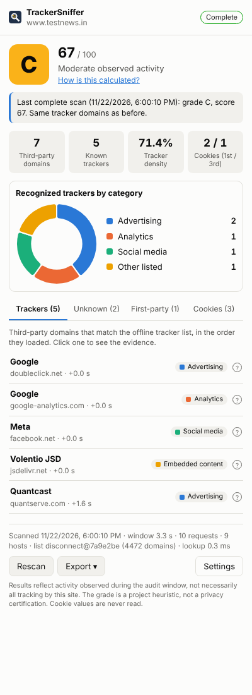

# TrackerSniffer — Third-Party Ad & Cookie Audit Extension

A Chrome extension (Manifest V3) that audits the website in the current tab. It works fully offline. It:

- records which third-party domains the page loads,
- reads cookie **metadata** (never cookie values),
- matches the domains against an offline, versioned tracker list (Disconnect, 4,472 domains),
- shows a transparent privacy score (0–100) and an A–F grade.

It only observes. It never blocks or changes requests, and it never sends data anywhere.

Project ID: PST_DA_014 · 2026 Level 3 (Stretch)



---

## 1. Run it in 2 minutes (no build needed)

**Requirements:** Google Chrome, Edge or Brave, version 116 or newer.

1. Download or clone this folder (`trackersniffer/`). The runtime libraries are already in `vendor/` and the tracker list is already in `data/trackers.json`, so `npm install` isn't needed just to run it.
2. Open `chrome://extensions`.
3. Turn on **Developer mode** (top-right switch).
4. Click **Load unpacked** and select the `trackersniffer` folder (the one that contains `manifest.json`).
5. Pin it: click the puzzle-piece icon in the toolbar, then the pin next to **TrackerSniffer**.
6. Open any website, for example `https://www.ndtv.com`. **Reload the page once.** Pages that were open before you installed the extension weren't observed, so they show "No data yet — Rescan".
7. Click the TrackerSniffer icon to see the grade, counts, category chart, tracker list, unknown domains, first-party domains and cookies.

While a page loads, the toolbar badge shows a live count of trackers. After an audit it shows the grade letter.

**After editing code:** go to `chrome://extensions` and click the ↻ reload icon on the TrackerSniffer card, then reload the website you're testing.

**Debugging:** on `chrome://extensions`, click **Service worker** on the card to open the background console. Right-click the popup and choose **Inspect** to open its DevTools.

## 2. Using the popup

| Control | What it does |
|---|---|
| **How is this calculated?** | Shows the exact score breakdown, e.g. `100 − 31 (trackers) − 2 (unknown) − 0.5 (cookies) = 67`. |
| **Trackers** tab | Listed third-party domains in load order, shown with plain-language owners ("Google", "Meta"). Click one to see its evidence: hostnames, match rule, list entry, categories, score weight, request count, and when it loaded. The **?** icon explains what the category does. |
| **Unknown** tab | Third-party domains that aren't on the list. These are shown as *unknown*, never as *safe*. |
| **First-party** tab | Domains that share the site's registrable domain. |
| **Cookies** tab | Cookie metadata only: name, domain, first- or third-party, Secure / HttpOnly / SameSite flags, and whether the domain is a tracker. |
| **Rescan** | Reloads the page, observes it for the configured window (10 s by default), then audits it again. |
| **Export** | Privacy report (`.md`), audit summary, domains, or cookie metadata (`.csv`). |
| **Settings** | Change grade thresholds and the rescan window, load an updated tracker list, and view or export the local audit history so you can compare sites. |

Other states you'll see:
- **Unsupported**: `chrome://` pages, `about:blank`, `file://` and similar.
- **No data yet**: the page loaded before the extension started.
- **Partial**: observation started late, or a cookie lookup failed.
- **Failed**: something went wrong. A clear message explains it, and the popup never shows misleading zeros.

If you scan a site again later, the popup also tells you about **new trackers since the last complete scan**.

## 3. "Deploying" it

A Chrome extension isn't hosted on a server. There are three ways to get it to people:

| Option | When to use it | How |
|---|---|---|
| **Load unpacked** | Your own machine, demos, the evaluator | Section 1 above. |
| **Share a zip** | Sending it to teammates or the evaluator | `npm run package` creates `dist/trackersniffer-v1.0.0.zip`. They unzip it and use **Load unpacked** on the folder. |
| **Chrome Web Store** (optional) | Public release | Pay the one-time developer registration fee at the [Chrome Web Store Developer Dashboard](https://chrome.google.com/webstore/devconsole), upload the zip, and fill in the privacy questions. Section 6 has the answers: no data collected or transmitted. Explain each permission (Section 6). Expect a review because `<all_urls>` and `webRequest` are broad permissions. |

The tracker data is licensed CC BY-NC-SA 4.0, which means **non-commercial use only**. Keep any store listing free and credit Disconnect.

## 4. Developer setup

Needs Node.js 18+ (tested with 22). Python 3.10+ with pandas and matplotlib is only needed for the optional analysis.

```bash
npm install            # dev tools only: tldts, chart.js, playwright-core
npm test               # 39 unit tests (node:test)
npm run evaluate       # labeled-set evaluation, writes docs/evaluation-results.md
npm run e2e            # loads the real extension in Chrome against a local fake site, writes docs/screenshots/
npm run package        # dist/extension/ + dist/trackersniffer-v1.0.0.zip
npm run fetch-list     # download the latest Disconnect list into data/raw/
npm run build-catalog  # clean it into data/trackers.json (+ data/catalog-build-log.json)
npm run vendor         # re-copy tldts + Chart.js from node_modules into vendor/
```

`npm run e2e` uses the Chrome at `/usr/bin/google-chrome` by default. Override it with `CHROME_PATH`. The test maps tracker hostnames to a local server with `--host-resolver-rules`, so it needs no internet.

On Windows PowerShell: `$env:CHROME_PATH="C:\Program Files\Google\Chrome\Application\chrome.exe"; npm run e2e`

## 5. How it works

```
 webRequest.onBeforeRequest (observe only) ─┐
 webNavigation.onCommitted (page boundary) ─┤→ background.js: per-tab hostnames, counts, first-seen times
                                            │   (stored in chrome.storage.session, survives worker restarts)
 popup opens → runAudit(tab) ───────────────┘
      ├─ chrome.cookies.getAll() for every observed registrable domain → metadata allow-list (no values)
      ├─ lib/domain.js   hostname extraction, normalization, Public-Suffix-List first/third-party rule
      ├─ lib/trackers.js exact / subdomain matching against data/trackers.json
      ├─ lib/score.js    score, grade, density
      └─ lib/audit.js    audit record + domain rows + cookie rows (data dictionary)
```

All logic in `src/lib/` is made of pure ES modules. The extension and the Node tests run the same code.

### First-party / third-party rule
A hostname is **first-party** when its *registrable domain* (eTLD+1) equals the audited site's registrable domain. This uses the Public Suffix List, including its private section, via `tldts`:
- `static.ndtv.com` on `www.ndtv.com` is first-party.
- `ndtvimg.com` is third-party, even though it's the same company.
- `user1.github.io` and `user2.github.io` are different sites.

IP addresses and single-label hosts are their own boundary. A hostname that can't be parsed is **uncertain**. Counts are made per registrable domain: `securepubads.g.doubleclick.net` and `stats.g.doubleclick.net` are one domain, `doubleclick.net`. The individual hostnames are kept as evidence.

### Tracker matching rules
1. Hostnames come from the `URL` parser, never from string splitting. Only http, https, ws and wss URLs carry hostnames; other schemes are counted as dropped.
2. Normalization: lowercase, and trim leading/trailing dots and whitespace. Nothing else changes; anything else invalid is rejected.
3. A hostname matches if it **equals** a list entry or is a **subdomain** of one. The matcher walks up one label at a time: `a.b.doubleclick.net` → `b.doubleclick.net` → `doubleclick.net`.
4. Because of this, `notdoubleclick.net`, `doubleclick.net.evil.com` and `doubleclick.network` never match `doubleclick.net`.
5. Unmatched domains are **unknown**. That never means safe.
6. CDNs, payment, login and embed domains are only counted as trackers if the list says so. Disconnect lists some CDNs under *Content*. Those are labeled "Embedded content" and cost 1 point.
7. Third-party domains are the only ones counted as trackers. A listed domain that is first-party (for example, auditing `doubleclick.net` itself) is shown with a note but not counted.

### Privacy score (project heuristic, not a certification)

```
score = 100 − Σ tracker weights − min(20, 1 × unknown third-party domains) − min(15, 0.5 × third-party cookies)
        clamped to 0–100, rounded
```

| Category | Points per tracker domain |
|---|---|
| Cryptomining | 10 |
| Fingerprinting | 8 |
| Advertising | 6 |
| Analytics, Social | 4 |
| Email tracking | 3 |
| Embedded content, Anti-fraud, Consent manager | 1 |

A domain listed in several categories is charged once, at its highest weight. For example, doubleclick.net (advertising + fingerprinting) costs 8.

| Score | Grade | Meaning |
|---|---|---|
| 90–100 | A | Low observed tracking activity under this model |
| 80–89 | B | Relatively low observed activity |
| 65–79 | C | Moderate observed activity |
| 50–64 | D | Elevated observed activity |
| 0–49 | F | High observed activity under this model |

You can change the thresholds in Settings (they're validated). The weights are in `src/lib/score.js`.

### Metrics
- **Tracker density** = recognized tracker domains ÷ unique third-party domains × 100. It shows **n/a** when no third-party domains were seen.
- **Third-party cookie ratio** = third-party cookies ÷ (first-party + third-party cookies) × 100. Uncertain cookies are reported separately.
- **Classification coverage** = domains with a known classification ÷ all observed domains.
- **Lookup time** is shown in the popup footer.

### The observation window
The audit covers everything seen from the start of the page's navigation until you open the popup. A page that keeps loading ads (lazy loading, scrolling) grows over time. **Rescan** gives a repeatable window. Requests from the previous page, such as a late favicon, are excluded: requests made before the new page commits are buffered and kept only if they belong to the committed document.

## 6. Permissions and data handling

| Permission | Why it's needed |
|---|---|
| `webRequest` | Observes request URLs to get hostnames. The listener is **non-blocking**: no `blocking` option and no `declarativeNetRequest`, so pages can't be broken by blocking. |
| `webNavigation` | Detects when a new page commits, so requests from the previous page aren't counted. |
| `cookies` | Reads cookie **metadata** (domain, name, flags, expiry) for domains seen in the audit. Values are never read. `toCookieMetadata()` copies an explicit allow-list of fields. |
| `storage` | `session`: per-tab observations, cleared when the browser closes. `local`: settings, an optional custom tracker list, and audit history. |
| `tabs` | Reads the active tab's URL to know which site is being audited, and reloads it on Rescan. |
| `host_permissions: <all_urls>` | Required for `webRequest` and `cookies` to see third-party requests and cookies on any site. |

**What is stored:**
- Hostnames and request counts per tab, in session storage only.
- For history: the site name, summary numbers and tracker domain names.

**What is never stored:**
- Cookie values.
- Full request URLs or query strings. The audited page URL is kept without its query or fragment.
- Form data.

**Transmission:** nothing is ever sent to a server. There is no analytics in the extension itself.

## 7. Project layout

```
manifest.json            MV3 manifest
src/background.js        service worker: observation, cookie lookup, audits, history, badge
src/lib/domain.js        URL → hostname, normalization, registrable domain, first/third-party
src/lib/trackers.js      tracker index, exact/subdomain matching, categories and explanations
src/lib/cookies.js       cookie metadata allow-list, expiry, Secure/HttpOnly/SameSite risk flags
src/lib/score.js         score formula, weights, thresholds, density
src/lib/audit.js         builds the audit (data dictionary A, B, C)
src/lib/export.js        CSV (formula-injection safe) and Markdown report
src/popup/               popup UI (Chart.js donut, tabs, evidence drawers, export)
src/options/             settings: thresholds, window, tracker-list upload, history comparison
vendor/                  tldts 7.5.5 (Public Suffix List) and Chart.js 4.6.1, bundled locally
data/raw/                raw Disconnect services.json + source.json (URL, commit, date, license)
data/trackers.json       cleaned catalog used at runtime
data/catalog-build-log.json  cleaning statistics
scripts/                 fetch/build list, evaluate, e2e test, package, vendor
tests/                   unit tests + labeled domain set (tests/fixtures/labeled-domains.json)
analysis/                optional sector study: sites.csv, sector_audit.mjs, analyze.py
docs/                    data dictionary, cleaning log, test report, evaluation results, findings report, screenshots
```

## 8. Optional sector analysis (stretch goal)

See [`analysis/README.md`](analysis/README.md). In short:

```bash
node analysis/sector_audit.mjs --wait 10      # audits the 100 sites in analysis/sites.csv with the real extension
pip install pandas matplotlib
python analysis/analyze.py                    # summary.md + 5 charts in analysis/output/
```

## 9. Known limitations
- **Only network requests are covered.** Fingerprinting scripts are flagged only if their domain is on the list. Canvas or WebGL calls aren't detected. Trackers served from first-party domains (CNAME cloaking, server-side tagging) look first-party.
- **List coverage.** Some real trackers aren't hostname entries in this list version, for example `googletagmanager.com` and `wzrkt.com`; they appear as Unknown. Disconnect's *Content* category also includes some CDNs (gstatic, jsdelivr). See `docs/evaluation-results.md`.
- **Cookies.** `chrome.cookies` returns every accessible cookie in the browser for the observed domains, not only cookies set by this page. Partitioned (CHIPS) cookies are included where Chrome supports `partitionKey`. Cookies in other profiles or incognito, and storage such as localStorage, aren't covered.
- **Requests not tied to a tab** aren't attributed: service-worker fetches, some prefetch and prerender requests, and browser-internal requests (`tabId = -1`).
- **Back/forward cache and prerender.** Pages restored this way without a network navigation are marked *partial*; use Rescan.
- **Grades depend on the window, consent choices and location.** The grade is a heuristic for comparison, not a legal or compliance assessment.
- **Recording starts at install.** Pages open before installation, and the first moments after Chrome restarts the extension's worker, aren't observed. The audit says so ("partial") instead of showing zeros.

## 10. PRD acceptance criteria

| # | Criterion | Where it's met |
|---|---|---|
| 1 | Runs in the documented Chrome environment | Chrome 116+ (`minimum_chrome_version`); e2e-tested on Chrome 153 |
| 2 | Identifies site origin, extracts hostnames | `background.js`, `domain.js`; tests in `domain.test.mjs`, e2e |
| 3 | First- vs third-party by documented rule | Section 5; `classifyParty()`; tests |
| 4 | No lookalike matches | `matchTracker()`; 12 of 12 lookalikes rejected (`docs/evaluation-results.md`) |
| 5 | Only cookie metadata, never values | `toCookieMetadata()` allow-list; unit test and e2e check that values never appear |
| 6 | Score and grade per documented formula | `score.js`; boundary tests |
| 7 | Trackers, categories and unknowns shown separately | Popup tabs and donut chart |
| 8 | Partial and failed audits reported clearly, no misleading zeros | `audit.js` returns null counts; e2e "no data" and "unsupported" checks |
| 9 | False-positive target met | Target 0 lookalike false positives: met |
| 10 | No observed page breakage | Read-only listeners; e2e check plus manual checklist in `docs/test-report.md` |
| 11 | Performance target met | 10,000 lookups in under 100 ms: about 9 ms |
| 12 | README covers permissions, data handling, scoring, limitations | This file |

## Credits and licenses
- Tracker data: [Disconnect tracking-protection list](https://github.com/disconnectme/disconnect-tracking-protection), © Disconnect, Inc., CC BY-NC-SA 4.0. Commit `7a9e2be`, retrieved 2026-11-22.
- [tldts](https://github.com/remusao/tldts) (MIT), which includes the Public Suffix List (MPL 2.0).
- [Chart.js](https://www.chartjs.org/) (MIT).
